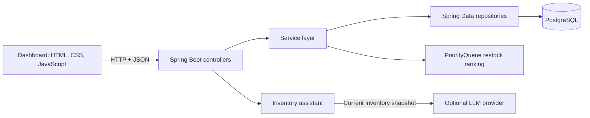

# Stockwise Inventory

Stockwise is a portfolio inventory-management demo with a responsive browser dashboard and a Spring Boot REST API. It models a small retail operation: products have SKUs, categories, storage locations, stock quantities, prices, and reorder points. A stock adjustment is recorded as an auditable movement, and an optional LLM assistant answers questions from a current inventory snapshot.

> This is an independent portfolio project and is not affiliated with Walmart or another retailer.

## What it demonstrates

- Java 21, Spring Boot, REST API design, and layered application structure
- PostgreSQL persistence with Spring Data JPA; H2 for repeatable tests
- Product CRUD, input validation, decimal money, duplicate-SKU handling, and consistent errors
- Stock updates with a movement history and optimistic locking to detect conflicting edits
- A `PriorityQueue` min-heap that prioritizes the lowest-stock products in the restock queue
- A responsive HTML/CSS/JavaScript dashboard that calls the REST API
- An optional LLM assistant configured through environment variables
- JUnit 5, Mockito, MockMvc integration tests, Maven, and GitHub Actions

## Architecture



The dashboard is served by Spring Boot, so the browser interface and API use the same local server. Product data is stored in PostgreSQL. To seed eight fictional sample products into an empty database for a portfolio demo, set `DEMO_DATA_ENABLED=true`. This is off by default, and the loader never adds samples to a catalog that already contains products.

## Run locally

### Requirements

- Java 21 or newer
- PostgreSQL
- IntelliJ IDEA (optional; the Maven wrapper also works in a terminal)

### Configure the database

Create a PostgreSQL database, for example `inventorydb`. In IntelliJ, open **Run → Edit Configurations**, select `InventoryApiApplication`, and add these environment variables using your own PostgreSQL settings:

```text
DATABASE_URL=jdbc:postgresql://localhost:5432/inventorydb
DATABASE_USERNAME=your_postgres_username
DATABASE_PASSWORD=your_postgres_password
DEMO_DATA_ENABLED=true
```

Never paste a real password or LLM key into `application.properties` or commit it. `application.properties` uses environment variables, and `.gitignore` excludes local `.env` files.

Run `InventoryApiApplication` from IntelliJ. Then open **http://localhost:8080/** to see the dashboard. The JSON product endpoint is **http://localhost:8080/api/products**.

You can also run from the project folder in a terminal:

```bash
export DATABASE_URL=jdbc:postgresql://localhost:5432/inventorydb
export DATABASE_USERNAME=your_postgres_username
export DATABASE_PASSWORD=your_postgres_password
export DEMO_DATA_ENABLED=true
./mvnw spring-boot:run
```

On Windows, use `mvnw.cmd spring-boot:run` in Command Prompt or PowerShell after setting the same environment variables.

## Dashboard features

- Search by product name, SKU, category, or location
- Filter by category or show only products that need restocking
- Add, edit, and delete products
- Record stock received or removed, with an adjustment reason
- Review recent stock activity and export the visible products as CSV
- Ask an inventory question through the assistant panel when an LLM key is configured

## REST API

Product JSON example:

```json
{
  "name": "Wireless Headphones",
  "sku": "AUD-2048",
  "category": "Electronics",
  "location": "Aisle 04 · Bay B",
  "quantity": 42,
  "price": 79.99,
  "reorderPoint": 12
}
```

| Method | Path | Purpose |
|---|---|---|
| GET | `/api/products` | List products |
| GET | `/api/products/{id}` | Get one product |
| POST | `/api/products` | Create a product |
| PUT | `/api/products/{id}` | Update a product |
| DELETE | `/api/products/{id}` | Delete a product without stock history |
| GET | `/api/products/restock` | Get low-stock products, lowest quantity first |
| POST | `/api/products/{id}/stock` | Adjust stock and record the reason |
| GET | `/api/products/{id}/stock-history` | View one product’s stock history |
| GET | `/api/products/activity` | Get the latest stock movements |
| POST | `/api/assistant/inventory` | Ask a question about current inventory |

To adjust stock, send `{"quantityChange":5,"reason":"Received shipment"}`. A negative change removes stock. The API rejects an adjustment that would make stock negative. Products with stock history are protected from deletion so their audit history is preserved.

### Data structures and concurrency

The restock endpoint uses Java’s `PriorityQueue` as a min-heap: products at or below their reorder point are queued, and the smallest quantities come out first. This keeps the most urgent items at the top. Products also have a JPA version field. If two requests try to edit the same product at once, the stale update is rejected with HTTP 409 so one stock update does not silently overwrite another.

## Optional LLM assistant

Set `LLM_API_KEY` in the IntelliJ run configuration to enable the assistant. Optional settings are `LLM_MODEL` and `LLM_API_URL`; the defaults target an OpenAI-compatible chat-completions endpoint. Without a key, the rest of the inventory app still works and the assistant explains that it is not configured. The assistant receives up to 200 current products, is instructed to answer only from that snapshot, and cannot update inventory.

## Tests

Run `./mvnw verify` on macOS/Linux or `mvnw.cmd verify` on Windows. The test profile uses an in-memory H2 database and requires no PostgreSQL service or API key.

- `InventoryApiApplicationTests` checks CRUD, validation, duplicate SKUs, stock history, negative-stock protection, restock ordering, the dashboard page, and assistant behavior without a key.
- `ProductServiceTests` checks service rules with JUnit 5 and Mockito, including duplicate SKUs, stock boundaries, history recording, and priority ordering.

## GitHub portfolio setup

1. Create an empty repository on GitHub.
2. In IntelliJ’s terminal, from this project folder, run the commands below and replace the URL with your repository URL.

```bash
git init
git add .
git status
git commit -m "Build Stockwise inventory dashboard"
git branch -M main
git remote add origin https://github.com/YOUR-USERNAME/YOUR-REPOSITORY.git
git push -u origin main
```

Review `git status` before committing and make sure passwords and API keys are not included. The GitHub Actions workflow at `.github/workflows/ci.yml` runs the Maven verification on pushes and pull requests.

## Resume description

**Stockwise Inventory Management System** — Built a full-stack inventory demo using Java, Spring Boot, PostgreSQL, and a responsive JavaScript dashboard. Implemented validated product APIs, auditable stock adjustments, optimistic locking, a priority-queue restock workflow, automated tests, and an optional LLM assistant grounded in live inventory data.
